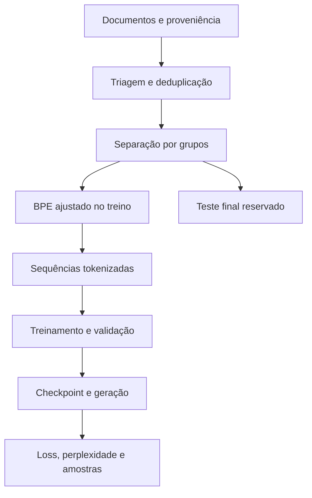

<p align="center">
  
</p>

<h1 align="center">Ignis-30M</h1>

<p align="center">
  <strong>Um modelo próprio. Do primeiro token aos pesos treinados.</strong><br>
  Modelo de linguagem autoregressivo em PyTorch, com prioridade para português e execução local.
</p>

<p align="center">
  
  
  
  
</p>

<p align="center">
  <a href="#arquitetura">Arquitetura</a> ·
  <a href="#uso">Uso rápido</a> ·
  <a href="#dados">Dados</a> ·
  <a href="#treinamento">Treinamento</a> ·
  <a href="#resultados">Avaliação</a> ·
  <a href="#limitacoes">Limitações</a>
</p>

| Modelo | Objetivo de treinamento | Implementação | Escala |
|:---|:---|:---|:---|
| **Ignis-30M · Base** | Previsão do próximo token | Transformer decoder-only | **30.416.384 parâmetros** |

> [!IMPORTANT]
> **O Ignis possui pesos treinados em experimentos reais, mas ainda não gera texto coerente de forma confiável.** É um projeto de pesquisa e engenharia de modelos de linguagem, não um assistente pronto para produção. Redução de loss não comprova compreensão, factualidade ou capacidade conversacional.

**Estado de referência:** código, configurações e resultados locais conferidos em **20/10/2026**. Os números abaixo são registros experimentais, não indicadores atualizados automaticamente. Documentos antigos em `docs/` podem descrever estágios anteriores.

---

<details>
<summary><strong>Explorar a documentação</strong> — arquitetura, uso, treinamento e avaliação</summary>

- [Propósito e aplicações](#proposito)
- [Estado atual](#estado)
- [Funcionamento e arquitetura](#arquitetura)
- [Requisitos e instalação](#instalacao)
- [Uso rápido e offline](#uso)
- [Inferência em Python](#inferencia)
- [Dados e tokenização](#dados)
- [Treinamento e recuperação](#treinamento)
- [Resultados medidos](#resultados)
- [Limitações](#limitacoes)
- [Testes e reprodutibilidade](#testes)
- [Estrutura do projeto](#estrutura)
- [Solução de problemas](#problemas)
- [Autoria, licenciamento e evidências](#referencias)

</details>

---

<a id="proposito"></a>
## Propósito e aplicações

**Ignis** é uma família experimental de *Small Language Models* — SLMs. **Ignis-30M** é seu primeiro modelo: um Transformer com **30.416.384 parâmetros treináveis**, implementado em PyTorch.

O projeto permite estudar o ciclo completo de um modelo próprio: origem dos dados, triagem, tokenização, arquitetura, otimização, checkpoints, geração e avaliação em hardware local. Os pesos foram inicializados aleatoriamente e atualizados com o corpus do projeto.

**Não foram importados pesos de Qwen, Llama ou outro modelo pré-treinado.** A inspiração arquitetural no Qwen3 não significa reprodução exata nem equivalência de capacidade ou desempenho.

| Finalidade | Aplicação atual |
|---|---|
| Pesquisa e formação | Estudar atenção causal, GQA, RoPE, RMSNorm e SwiGLU |
| Engenharia de dados | Investigar proveniência, PII, deduplicação e isolamento dos splits |
| Treinamento de SLMs | Experimentar AdamW, scheduler, acumulação e recuperação de estado |
| Avaliação científica | Medir loss, perplexidade, repetição e sensibilidade ao contexto |
| Computação local | Executar pesos e avaliações em CPU/CUDA, inclusive offline |

**Prioridade de linguagem:** português brasileiro. A Wikipédia em português contém variedades da língua; isso não equivale a uma curadoria exclusiva de pt-BR. Programação é um domínio secundário pretendido, cuja competência ainda não foi demonstrada.

<a id="estado"></a>
## Estado atual

| Componente | Situação documentada |
|---|---|
| Modelo e configuração tipada | Implementados, com contagem exata verificada |
| Pipeline de dados e BPE | Implementados e utilizados com corpus real |
| Treinamento real | Piloto de 200 passos + duas fases de 1.000 passos |
| Geração | Autoregressiva, com greedy, temperatura, top-k e top-p |
| Avaliação | Validação completa e diagnósticos de contexto executados |
| Qualidade textual | Insuficiente: repetição, perda de assunto e inconsistência |
| Conversação e instruções | Não demonstradas; sem SFT conversacional documentado |
| RAG, interface de chat e servidor de API | Trabalho futuro |
| GGUF, quantização e integração Ollama | Não implementados no fluxo documentado |

> [!TIP]
> Use o projeto hoje para **experimentação e aprendizado sobre modelos de linguagem**. Para testar o checkpoint existente, comece pela avaliação; não é necessário treinar novamente.

O modelo não deve ser tratado como fonte factual, sistema de decisão ou assistente de produção. Os experimentos não sustentam uso em respostas que exijam confiabilidade médica, jurídica, financeira ou operacional.

<a id="arquitetura"></a>
## Funcionamento e arquitetura

O Ignis aprende a **prever o próximo token** a partir dos anteriores. Na geração, o token escolhido é acrescentado à entrada e o processo se repete.

$$
p_\theta(x_1,\ldots,x_T)=\prod_{t=1}^{T}p_\theta(x_t\mid x_{<t})
$$

A saída tem formato `[lote, comprimento, vocabulário]`. A atenção causal impede que cada posição acesse tokens futuros. A geração usa somente o contexto fornecido e os pesos aprendidos; recuperação de documentos externos não está implementada.



Fontes de verdade: [`configs/ignis-30m.yaml`](configs/ignis-30m.yaml) e [`src/ignis/model/`](src/ignis/model/).

| Propriedade | Configuração |
|---|---:|
| Arquitetura | Transformer decoder-only |
| Camadas | 7 |
| Dimensão do modelo | 512 |
| Cabeças de consulta — Q | 8 |
| Cabeças de chave/valor — KV | 4 |
| Dimensão por cabeça | 64 |
| Atenção | GQA causal |
| Posição | RoPE, `theta=10000` |
| Normalização | RMSNorm, `eps=1e-5` |
| MLP | SwiGLU, intermediária de 1.536 |
| Vocabulário | 16.384, incluindo especiais |
| Contexto configurado | 1.024 tokens |
| Embeddings de entrada/saída | Compartilhados |
| Vieses nas projeções lineares | Desativados |
| Dropout do baseline | 0,0 |
| **Parâmetros treináveis** | **30.416.384** |

> [!NOTE]
> **Contexto configurado não é contexto treinado.** Os pilotos usaram blocos de 128 e entradas efetivas de 127 tokens. Não foi demonstrada qualidade em sequências de 1.024 tokens. A geração atual não aplica truncamento automático nem janela deslizante.

### Como funciona cada bloco

Os IDs produzidos pelo BPE passam por um embedding de dimensão 512 e por sete blocos com normalização antes de cada subcamada (*pre-norm*). Cada bloco preserva a entrada por conexões residuais:

$$
u = h + \operatorname{GQA}(\operatorname{RMSNorm}(h)),\qquad
h' = u + \operatorname{SwiGLU}(\operatorname{RMSNorm}(u))
$$

Na atenção, oito cabeças de consulta compartilham quatro pares de cabeças de chave/valor: duas cabeças Q por par KV. RoPE aplica informação de posição às consultas e chaves. A máscara causal restringe a atenção ao prefixo disponível. A implementação está em [`attention.py`](src/ignis/model/attention.py).

A rede feed-forward expande os vetores para 1.536 dimensões, aplica uma porta SiLU e projeta o resultado de volta para 512:

$$
\operatorname{SwiGLU}(h)=W_{\mathrm{down}}\left(\operatorname{SiLU}(W_{\mathrm{gate}}h)\odot W_{\mathrm{up}}h\right)
$$

Depois do último bloco, uma RMSNorm final e a projeção com pesos compartilhados com o embedding produzem um logit para cada token do vocabulário. O treinamento compara esses logits com o próximo token real; a inferência escolhe o próximo token por greedy ou amostragem. As matrizes lineares e os embeddings recebem inicialização normal com desvio padrão `0.02`, conforme [`transformer.py`](src/ignis/model/transformer.py).

<details>
<summary><strong>Derivação da contagem de parâmetros</strong></summary>

| Componente | Parâmetros |
|---|---:|
| Embedding compartilhado: `16384 × 512` | 8.388.608 |
| Atenção por camada | 786.432 |
| MLP por camada: `3 × 512 × 1536` | 2.359.296 |
| Duas RMSNorm por camada: `2 × 512` | 1.024 |
| Sete blocos completos | 22.027.264 |
| RMSNorm final | 512 |
| **Total** | **30.416.384** |

$$
P=16384\cdot512+7\left(786432+3\cdot512\cdot1536+2\cdot512\right)+512
$$

A projeção de saída não acrescenta outra matriz independente, pois compartilha o embedding. Derivação implementada em [`param_count.py`](src/ignis/model/param_count.py).

```powershell
.\.venv-cuda\Scripts\python.exe scripts\count_params.py
```

</details>

### Memória: estimativa não é benchmark

Somente os pesos FP32 ocupam aproximadamente **116 MiB**. Pesos, gradientes e dois momentos FP32 do AdamW somam aproximadamente **464 MiB**, antes de ativações, logits e custos do processo. **Esses valores não são requisitos mínimos medidos de RAM/VRAM.** O consumo real depende de contexto, microbatch, precisão e backend.

<a id="instalacao"></a>
## Requisitos e instalação

| Item | Ambiente observado nos experimentos |
|---|---|
| Sistema principal | Windows com PowerShell |
| Python do ambiente CUDA | 3.13 |
| PyTorch | `2.14.1+cu126` |
| GPU utilizada | NVIDIA GeForce RTX 4050 Laptop GPU |
| Precisão dos pilotos reais | FP32, `mixed_precision="no"` |
| CPU | Suportada; testes reduzidos executados em CPU |

O pacote declara **Python >= 3.10**. Isso não significa que todas as combinações de versões e sistemas foram testadas. Dependências e extras estão em [`pyproject.toml`](pyproject.toml).

### Ambiente local já preparado

```powershell
cd E:\Models\Ignis

.\.venv-cuda\Scripts\python.exe -c "import torch; print(torch.__version__); print('CUDA:', torch.cuda.is_available()); print(torch.cuda.get_device_name(0) if torch.cuda.is_available() else 'CPU')"
.\.venv-cuda\Scripts\python.exe -m ignis.cli --help
```

O executável é chamado diretamente, sem necessidade de ativar o virtualenv. `.venv-cuda` não acompanha o repositório. Não recrie um ambiente existente apenas para executar uma avaliação.

<details>
<summary><strong>Instalação nova em CPU — Windows</strong></summary>

Exemplo para instalação nova, sem substituir ambientes anteriores:

```powershell
py -m venv .venv
.\.venv\Scripts\python.exe -m pip install torch --index-url https://download.pytorch.org/whl/cpu
.\.venv\Scripts\python.exe -m pip install -e ".[dev,training]"
.\.venv\Scripts\python.exe -m ignis.cli --help
```

`dev` inclui `pytest` e `psutil`; `training` inclui `safetensors`. Instalar o código não fornece corpus, BPE ajustado nem pesos. Use o Python de `.venv` e `--device cpu` nos comandos de avaliação.

</details>

<details>
<summary><strong>Instalação nova em CPU — Linux</strong></summary>

```bash
python3 -m venv .venv
.venv/bin/python -m pip install torch --index-url https://download.pytorch.org/whl/cpu
.venv/bin/python -m pip install -e ".[dev,training]"
.venv/bin/python -m ignis.cli --help
```

Exemplo de instalação, não evidência de benchmark nesse sistema. Os exemplos seguintes usam o ambiente Windows observado.

</details>

### CUDA

A build de PyTorch deve ser compatível com hardware e driver. A configuração observada já dispõe de `.venv-cuda`; não exige reinstalação para gerar texto.

- [Diagnóstico de hardware](scripts/diagnostico_hardware.ps1).
- [Verificação de PyTorch/CUDA](scripts/verificar_gpu_cuda.py).
- [Histórico da preparação do ambiente CUDA separado](docs/plano-migracao-cuda.md).

Não presuma que uma VM ou terminal remoto tenha acesso à GPU do Windows. Dependências declaradas com versões mínimas também não substituem um registro de ambiente reproduzível.

<a id="uso"></a>
## Uso rápido e offline

### Artefatos necessários

| Caminho local | Finalidade |
|---|---|
| `configs/ignis-30m.yaml` | Reconstrução da arquitetura |
| `data/piloto_corpus_v1/tokenizer_naooficial.json` | IDs compatíveis com os pesos |
| `checkpoints/pilot-corpus-v1-fase3a-controle/best.pt` | Checkpoint de referência atual |
| `data/piloto_corpus_v1/splits.json` | Rastreabilidade dos dados |
| `tokenizado_validacao.*` na pasta de dados | Avaliação completa |

**Dados, checkpoints e ambientes virtuais são ignorados pelo Git.** Um checkout novo não recebe automaticamente os pesos treinados. Não há download público de pesos documentado aqui.

### Avaliar o melhor checkpoint

```powershell
.\.venv-cuda\Scripts\python.exe -u scripts\avaliar_checkpoint.py `
  --checkpoint checkpoints\pilot-corpus-v1-fase3a-controle\best.pt `
  --device cuda
```

O script verifica arquitetura, tokenizador e splits; avalia toda a validação e gera dez continuações: cinco prompts em greedy e amostragem. Cria `docs/experiments/avaliacao_checkpoint_<data_hora>/relatorio.json`, sem atualizar pesos ou usar o teste final.

Em CPU, use `--device cpu`. O padrão de checkpoint desse script ainda aponta para a **fase 2**: informe o caminho explicitamente para avaliar a fase 3A.

### Diagnosticar treino, validação e uso de contexto

```powershell
.\.venv-cuda\Scripts\python.exe -u scripts\diagnosticar_modelo.py --device cuda
```

O padrão é o `best.pt` da fase 3A. O script avalia os splits completos, compara com unigrama ajustado no treino, perturba o contexto de 512 alvos e mede indicadores lexicais exploratórios. Não treina pesos nem usa o teste final.

| Operação | Internet necessária? |
|---|---|
| Geração com pesos/dependências locais | Não |
| Avaliação com datasets locais | Não |
| Treinamento com dados já preparados | Não |
| Verificação de integridade local | Não |
| Coleta de artigos | Sim |
| Instalação inicial de pacotes | Normalmente sim, salvo instalação por arquivos locais |

O modelo não exige Ollama nem uma API de inferência externa. Colocar arquivos novos numa pasta não altera o conhecimento dos pesos: treinamento e recuperação de documentos são processos distintos.

<a id="inferencia"></a>
## Inferência em Python

<details>
<summary><strong>Exemplo completo: carregar pesos e gerar uma continuação</strong></summary>

Salve o código como `exemplo_inferencia.py` em UTF-8 na raiz do projeto. Os artefatos locais indicados na seção anterior precisam existir. Não há treinamento nem acesso à internet no exemplo.

```python
"""Geração experimental local com o checkpoint da fase 3A."""

import json
from pathlib import Path

import torch

from ignis.config import IgnisConfig
from ignis.inference.generate import generate
from ignis.model import IgnisModel
from ignis.tokenizer.bpe import ID_BOS, ID_EOS, IgnisTokenizer
from ignis.training.checkpoint import load_checkpoint, sha256_arquivo


@torch.inference_mode()
def executar():
    base = Path("data/piloto_corpus_v1")
    caminho_tokenizador = base / "tokenizer_naooficial.json"
    caminho_checkpoint = Path("checkpoints/pilot-corpus-v1-fase3a-controle/best.pt")
    dispositivo = "cuda" if torch.cuda.is_available() else "cpu"
    config = IgnisConfig.from_yaml("configs/ignis-30m.yaml").modelo
    modelo = IgnisModel(config)

    # Carregue somente checkpoints de procedência conhecida.
    estado = load_checkpoint(
        caminho_checkpoint, modelo, map_location="cpu", restaurar_rng=False
    )
    metadados = estado.get("metadata", {})
    if metadados.get("config_modelo") != config.model_dump():
        raise RuntimeError("Arquitetura incompatível.")
    if metadados.get("tokenizer_sha256") != sha256_arquivo(caminho_tokenizador):
        raise RuntimeError("Tokenizador incompatível.")
    if metadados.get("dataset_sha256") != sha256_arquivo(base / "splits.json"):
        raise RuntimeError("Splits incompatíveis.")
    del estado  # Libera a cópia do estado de treinamento carregada em CPU.

    tokenizador = IgnisTokenizer.load(caminho_tokenizador)
    if tokenizador.vocab_size != config.vocab_size:
        raise RuntimeError("Vocabulário incompatível.")
    modelo.to(dispositivo).eval()

    prompt = "A energia solar pode ser utilizada para"
    ids = [ID_BOS] + tokenizador.encode(prompt, adicionar_bos_eos=False)
    # Mantém o exemplo no tamanho experimental dos pilotos.
    limite = min(64, 128 - len(ids))
    if limite <= 0:
        raise ValueError("Prompt longo demais para este exemplo.")
    entrada = torch.tensor([ids], dtype=torch.long, device=dispositivo)
    saida = generate(
        modelo, entrada, max_new_tokens=limite,
        temperature=0.8, top_k=40, top_p=0.9,
        eos_token_id=ID_EOS, seed=42,
    )
    novos_ids = saida[0, len(ids):].tolist()
    print(json.dumps({
        "dispositivo": dispositivo,
        "prompt": prompt,
        "continuacao": tokenizador.decode(novos_ids),
        "tokens_gerados": len(novos_ids),
    }, ensure_ascii=False, indent=2))


if __name__ == "__main__":
    executar()
```

```powershell
.\.venv-cuda\Scripts\python.exe exemplo_inferencia.py
```

O resultado não deve ser interpretado como uma resposta correta sobre energia solar. `generate()` retorna entrada + continuação; o recorte `len(ids):` seleciona somente os novos tokens.

</details>

| Argumento de `generate()` | Comportamento |
|---|---|
| `max_new_tokens` | Limita o número de tokens acrescentados |
| `temperature <= 0` | Greedy: seleciona o maior escore |
| `temperature > 0` | Amostra com ajuste de temperatura |
| `top_k` | Restringe os candidatos pelos maiores escores |
| `top_p` | Restringe candidatos por massa acumulada de probabilidade |
| `eos_token_id` | Define o token de encerramento |
| `seed` | Semeia a amostragem; não garante igualdade entre backends |

Não há cache KV, penalidade de repetição ou streaming nessa função. A condição EOS encerra o laço quando todos os elementos do lote produzem EOS no mesmo passo, sem controlar sequências encerradas individualmente. O exemplo usa lote um.

<a id="dados"></a>
## Dados e tokenização

### Coleta bruta não é o dataset já treinado

| Conjunto | Estado registrado |
|---|---|
| Coleta bruta local mais recente | 1.331 artigos; 7.776.336 bytes de texto; 1.174.290 tokens aproximados por espaços |
| Snapshot dos pilotos | `data/piloto_corpus_v1/`, congelado antes dos artigos novos |
| Documentos no piloto | 1.063 treino; 71 validação; 11 teste |
| Tokens BPE de treino, incluindo especiais | 1.518.907 |
| Sequências de treino / validação / teste | 11.867 / 664 / 139 |
| Bloco empacotado | 128 tokens |
| Entrada e alvo deslocados | 127 posições por sequência |

Novos artigos coletados **não alimentaram automaticamente os checkpoints anteriores**. Precisam de triagem e de uma versão nova dos dados.

> [!NOTE]
> A coleta conta unidades separadas por espaços; o dataset usa BPE byte-level. Tokens com especiais, posições-alvo após deslocamento e tokens processados em várias épocas são medidas diferentes. Repetições do dataset não acrescentam documentos únicos.

### Fluxo de preparação

1. Ingerir documentos com origem, licença e identificador.
2. Normalizar texto, preservando conteúdo técnico e fórmulas.
3. Aplicar filtros de qualidade e detecção heurística de PII.
4. Deduplicar e agrupar quase-duplicatas.
5. Separar treino/validação/teste por unidades relacionadas.
6. Ajustar o BPE apenas no treino de uma versão inicial.
7. Empacotar cada split separadamente e auditar os artefatos.

`fonte` identifica proveniência, como `wikipedia-pt`; não é necessariamente a unidade de agrupamento contra vazamento. Arquivos iniciados por `_`, como `_metadados.jsonl` e `_estado_coleta.json`, são auxiliares e não viram conteúdo de treino.

### Tokenizador

O BPE tem 16.384 tokens incluindo especiais. O nome `tokenizer_naooficial.json` foi preservado por razões históricas; a auditoria salva do piloto registra `oficial_do_piloto=true` **para aquele snapshot**. Isso não certifica automaticamente dados futuros.

**Não reajuste outro BPE ao continuar os pesos existentes:** mesmo vocabulário de tamanho igual pode ter outra correspondência entre token e ID. A geração exige o tokenizador associado ao checkpoint.

### CLI disponível

| Subcomando | Função |
|---|---|
| `validate-corpus` | Ingestão, triagem e manifesto |
| `prepare-splits` | Separação inicial dos documentos |
| `train-tokenizer` | Ajuste de um BPE novo exclusivamente no treino |
| `eval-tokenizer` | Round-trip e métricas de tokenização |
| `prepare-dataset` | Empacotamento dos splits em sequências |
| `audit-tokenizer` | Verificação dos critérios do piloto |
| `report` | Relatório consolidado |
| `train` | Dry-run e, com flag explícita, treinamento |

```powershell
.\.venv-cuda\Scripts\python.exe -m ignis.cli --help
.\.venv-cuda\Scripts\python.exe -m ignis.cli prepare-dataset --help
.\.venv-cuda\Scripts\python.exe -m ignis.cli audit-tokenizer --help
```

<details>
<summary><strong>Exemplo de preparação de uma versão nova de dados</strong></summary>

Os destinos abaixo são novos caminhos experimentais. Não substituem o piloto existente.

```powershell
# Triagem local em manifesto separado.
.\.venv-cuda\Scripts\python.exe -m ignis.cli validate-corpus `
  --corpus-dir corpus_real\wikipedia_pt --fonte wikipedia-pt `
  --manifesto-saida data\corpus_v2_experimental\manifesto.jsonl
```

Após revisar a triagem, construir splits versionados preservando grupos, atribuições históricas e teste congelado. **Não use `prepare-splits` cegamente para refazer o teste existente.** O arquivo de splits mencionado a seguir exige criação e revisão prévias; não é gerado pelo comando acima.

```powershell
# Empacotamento com o mesmo tokenizador dos pesos atuais.
.\.venv-cuda\Scripts\python.exe -m ignis.cli prepare-dataset `
  --tokenizer data\piloto_corpus_v1\tokenizer_naooficial.json `
  --corpus-dir corpus_real\wikipedia_pt `
  --manifesto data\corpus_v2_experimental\manifesto.jsonl `
  --splits data\corpus_v2_experimental\splits.json `
  --saida-base data\corpus_v2_experimental\tokenizado --seq-len 128
```

Esses comandos de dados não atualizam pesos do modelo.

</details>

### Coleta da Wikipédia

O coletor usa a API da Wikipédia em português, registra pageid, revisão, URL, data e hashes, mantém estado incremental e trata `Retry-After`, HTTP 429 e `maxlag`.

```powershell
# Verificação de integridade local, sem rede.
.\.venv-cuda\Scripts\python.exe scripts\coletar_wikipedia_pt.py `
  --verificar --saida-dir corpus_real\wikipedia_pt

# Exemplo de plano limitado; sem --confirmar não baixa nada.
.\.venv-cuda\Scripts\python.exe scripts\coletar_wikipedia_pt.py `
  --meta-tokens 3000000 --teto-mb 500 --max-requisicoes 100 `
  --pausa-s 6 --saida-dir corpus_real\wikipedia_pt
```

`--confirmar` ativa a coleta real. O exemplo de 100 consultas é apenas um plano, não a definição do saldo de uma autorização de coleta. O limite de consultas é por execução; não reinicie indefinidamente para contornar a cota planejada.

O teto conta **bytes de texto UTF-8 dos extratos**, não todo o tráfego HTTP. A meta aproximada de 3 milhões e o teto de texto são diferentes do orçamento de treinamento.

Na última tentativa documentada, houve timeout/`WinError 10051` ao acessar a Wikipédia. Isso não comprova indisponibilidade global. O estado foi salvo e a integridade dos 1.331 artigos foi verificada. Avaliar arquivos locais não depende dessa conexão.

<a id="treinamento"></a>
## Treinamento e recuperação

### Objetivo e otimização

O treino minimiza entropia cruzada nas posições-alvo válidas, ignorando padding:

$$
\mathcal{L}=-\frac{1}{N}\sum_{t\in\mathcal{V}}\log p_\theta(x_t\mid x_{<t}),
\qquad \mathrm{PPL}=e^{\mathcal{L}}
$$

$\mathcal{V}$ é o conjunto das posições válidas e $N=|\mathcal{V}|$. A perplexidade só deve ser comparada com tokenizador, split e procedimento compatíveis; não é porcentagem de acertos ou nota de conversação.

O treinador implementa AdamW, warmup linear, decaimento em cosseno, clipping, acúmulo de gradientes, validação, checkpoints e parada por falhas numéricas ou de memória. BF16 e FP16 são opções de código; os pilotos reportados usaram FP32. A opção de precisão mista não constitui benchmark de desempenho.

### Modelo novo versus continuação dos pesos

> [!WARNING]
> **`ignis.cli train` cria um modelo novo.** Não carrega automaticamente `best.pt`. As fases seguintes usam executores específicos que carregam pesos anteriores, verificam hashes e iniciam outro experimento de otimização.

| Entrada | Modo sem flag real | Pesos de origem |
|---|---|---|
| `python -m ignis.cli train --config ...` | Dry-run | Inicialização aleatória |
| `scripts/treinar_fase2.py` | Preparação da fase 2 | Piloto, passo 200 |
| `scripts/treinar_fase3.py` | Validação inicial e plano | Fase 2, passo 1.000 |

As fases 2 e 3A já foram concluídas localmente. Os executores recusam pastas de saída existentes: repetir o comando não inicia uma fase nova. Possuem limites e hashes específicos; não são executores genéricos de qualquer experimento.

<details>
<summary><strong>Comandos históricos de preparação e treinamento</strong></summary>

Exemplos documentais do fluxo; não é necessário repetir os experimentos concluídos:

```powershell
# Preparação de um piloto novo, sem atualizar pesos.
.\.venv-cuda\Scripts\python.exe -m ignis.cli train `
  --config configs\train-pilot-corpus-v1.yaml --device cuda

# Preparação da fase 3A, com saída ainda inexistente.
.\.venv-cuda\Scripts\python.exe -u scripts\treinar_fase3.py

# EXECUÇÃO REAL: atualiza pesos e consome o orçamento configurado.
.\.venv-cuda\Scripts\python.exe -u scripts\treinar_fase3.py `
  --iniciar-treinamento-real
```

O início real requer verificações aprovadas e decisão explícita sobre o orçamento.

</details>

### Configuração da fase 3A concluída

| Item | Valor |
|---|---:|
| Passos adicionais máximos | 1.000 |
| Microbatch / acúmulo / lote efetivo | 1 / 32 / 32 |
| LR inicial / mínima | `5e-5` / `5e-6` |
| Warmup | 50 passos |
| Validação e checkpoint | A cada 100 passos |
| Validação completa | 664 lotes de uma sequência |
| Paciência | Três avaliações sem melhora |
| Melhor checkpoint | `checkpoints/pilot-corpus-v1-fase3a-controle/best.pt` |

O `best.pt` é salvo no início e substituído quando a validação melhora. Na fase 3A, o melhor passo local foi 1.000. Novo otimizador e novo scheduler definem uma fase nova, não retomada exata do scheduler anterior.

### Artefatos

| Arquivo | Conteúdo |
|---|---|
| `.pt` | Pesos, otimizador quando informado, RNG, contadores, configuração e metadados |
| `.safetensors` | Somente pesos; exportação opcional compatível com embeddings compartilhados |
| `metricas.jsonl` | Métricas de treino/validação, checkpoints e eventos |
| `origem_e_configuracao.json` | Rastreabilidade nas fases que produzem esse arquivo |
| `resultado.json` | Resumo final das fases 2 e 3A |

Novos checkpoints do treinador preservam cursor na época, paciência e estado do GradScaler. O RNG CUDA é registrado quando inicializado. A equivalência testada em CPU exige loader determinístico reconstruído por seed/época, `num_workers=0` e ausência de transformações aleatórias.

- Legados sem cursor não permitem recuperar retrospectivamente a posição exata.
- O piloto inicial não registrou hash dos splits; sua avaliação usa `--permitir-splits-sem-hash` e registra `origem_nao_verificada`. A opção não libera hashes divergentes.
- Gradientes parciais não são persistidos. Checkpoints de emergência não garantem retomada exata.
- A cauda incompleta da época continua descartada sem `optimizer.step`, agora com evento nas métricas. No piloto, 11.867 microbatches com acúmulo 32 deixam 27 na cauda de cada época completa.
- `max_steps` define o horizonte do scheduler. Alterá-lo muda a curva de LR. Para parada operacional dentro do mesmo horizonte, a API oferece `parar_no_passo`.
- A configuração é registrada no checkpoint; o chamador deve manter parâmetros e dados compatíveis ao retomar.

Os `.pt` usam `weights_only=False` para recuperar também objetos de treinamento. **Carregue somente checkpoints de procedência conhecida.** Safetensors não contém o estado completo para retomar o AdamW.

<a id="resultados"></a>
## Resultados medidos

### Validação completa comparável

Mesmo tokenizador e mesma validação histórica: **664 sequências, 84.265 posições-alvo**. O teste final permaneceu reservado.[^avaliacao]

| Experimento | Passos locais | Passos acumulados | Loss | Perplexidade |
|---|---:|---:|---:|---:|
| Piloto, checkpoint 200 | 200 | 200 | 6,9928 | 1.088,79 |
| Fase 2, checkpoint 1.000 | 1.000 | 1.200 | 6,1326 | 460,63 |
| **Fase 3A, melhor checkpoint** | **1.000** | **2.200** | **5,9521** | **384,55** |

As primeiras avaliações durante o piloto eram parciais. Os valores acima vêm da reavaliação completa, não de uma mistura desses procedimentos.

| Execução | Contador de posições-alvo processadas | Tempo reportado |
|---|---:|---:|
| Piloto | 812.800 | 270,33 s |
| Fase 2 | 4.063.862 | 1.139,50 s |
| Fase 3A | 4.063.862 | 1.306,43 s |

Os aproximadamente 8,94 milhões de alvos processados incluem repetição do corpus. Tempos são registros locais, não previsões para outro equipamento. A fase 3A reduziu a loss em **2,94%** e a perplexidade em **16,52%** em relação à fase 2.

### Diagnóstico do checkpoint da fase 3A

| Avaliação completa | Loss | Perplexidade |
|---|---:|---:|
| Treino: 1.507.040 posições-alvo | 5,4717 | 237,86 |
| Validação: 84.265 posições-alvo | 5,9521 | 384,55 |

Gap de loss: aproximadamente **0,4804**. Um baseline unigrama ajustado apenas no treino obteve loss **7,6355** na validação. O modelo supera essa referência simples, sem demonstrar por isso compreensão.[^diagnostico]

| Controle em 512 alvos da validação | Loss média |
|---|---:|
| Prefixo original | 5,9137 |
| Prefixo anterior ao último token embaralhado | 6,5619 |
| Último token apenas | 6,6858 |

A ordem original beneficiou **68,55%** dos alvos. No controle embaralhado, alvo, último token, comprimento e multiconjunto do prefixo foram preservados. Há uma seed e blocos não são documentos independentes; o controle último-token-apenas também muda o comprimento. Essas médias não substituem a loss de validação completa.

### Falhas reais de geração

| Prompt | Trecho greedy observado | Problema |
|---|---|---|
| `O Brasil é um país` | `de futebol, que é uma das das primeiras vezes...` | Relação semântica inadequada e repetição |
| `A energia solar pode ser utilizada para` | `a cidade de Janeiro, e a primeira vez...` | Perda de assunto |
| `Na matemática, uma função` | `de um grupo de futebol...` | Deriva entre domínios |

Trechos abreviados; as amostras completas estão nos relatórios. Cinco prompts e uma seed de amostragem não são um benchmark abrangente. O protocolo mede continuação de texto, não diálogo.

<a id="limitacoes"></a>
## Limitações

> [!CAUTION]
> **Pipeline funcionando não significa modelo pronto.** Há aprendizagem quantitativa e uso de contexto medidos, mas não geração confiável nem prontidão para produção.

| Área | Limitação | Consequência |
|---|---|---|
| Coerência | Frases desconexas e mudança de assunto | Respostas não confiáveis |
| Repetição | Ciclos de palavras, datas e títulos editoriais | Greedy pode se prender em padrões |
| Factualidade | Combina entidades e datas sem sustentação | Texto plausível não é informação verificada |
| Dados | Uma fonte e corpus pequeno, cobertura em revisão | Generalização limitada |
| Português brasileiro | Corpus em português não exclusivamente pt-BR | Estilo regional não garantido |
| Programação | Sem benchmark específico | Capacidade não demonstrada |
| Contexto longo | Entrada de 127 tokens nos pilotos | 1.024 configurados não são qualidade validada |
| Inferência | Sem cache KV; forward completo por token | Custo cresce com o prefixo |
| Controle de contexto | Sem truncamento automático nem janela deslizante | Chamador deve limitar os comprimentos |
| EOS em lote | Sem parada individual de sequências | Exemplo recomendado em lote um |
| Conversação | Sem SFT/alinhamento/template de chat validado | Não é um chatbot pronto |
| Determinismo | Kernels CUDA podem ser não determinísticos | Seed igual não garante igualdade bit a bit |
| Recuperação | Legados e emergência têm restrições | Retomada exata não é garantia geral |
| Privacidade | Detector PII heurístico | Revisão contextual permanece necessária |
| Avaliação | Sem benchmark externo amplo ou avaliação final em teste | Conclusões restritas aos experimentos |
| Integração | Sem servidor de API, interface de chat, GGUF ou Ollama | Uso atual por scripts/API Python |
| Distribuição | Licenças de dados e derivados exigem análise própria | Pesos e dados não são automaticamente liberados |

### Conteúdo editorial

Títulos como **Referências**, **Ligações externas**, **Bibliografia**, **Notas** e **Ver também** aparecem em 96,52% dos documentos de treino. O trecho após o primeiro desses títulos corresponde a aproximadamente 5,55% dos tokens e pode conter informação legítima.[^editorial]

Isso sustenta revisar os dados, sem provar que esses títulos expliquem sozinhos a baixa qualidade. **Não foi aplicada remoção indiscriminada das seções.** Os indicadores lexicais do diagnóstico são exploratórios e sobrepostos, não classificação temática validada.

<a id="testes"></a>
## Testes e reprodutibilidade

Última suíte completa registrada antes desta revisão documental: **202 testes aprovados, 25 avisos, 48,06 s**.[^diagnostico] É evidência histórica, não selo automático de CI. Os avisos são da API depreciada de `GradScaler`.

| Grupo | Verificações |
|---|---|
| Modelo | Shapes, causalidade, gradientes, parâmetros e pesos compartilhados |
| Dados | Normalização, filtros, PII, deduplicação, splits e contaminação |
| BPE | Ajuste, round-trip e auditoria |
| Treinamento | Atualização em modelo reduzido, limites, scheduler e tratamento de falhas |
| Recuperação | Pesos/AdamW/RNG em CPU, cursor, paciência e melhor checkpoint |
| Diagnósticos | Padding, ponderação por alvo e controles de contexto |

Para repetir no Windows, com temporários em pasta nova e uma thread OMP/MKL:

```powershell
$pastaTeste = Join-Path $PWD ("tmp_testes_" + [guid]::NewGuid().ToString("N"))
New-Item -ItemType Directory -Path $pastaTeste | Out-Null
$env:TEMP = $pastaTeste
$env:TMP = $pastaTeste
$env:OMP_NUM_THREADS = "1"
$env:MKL_NUM_THREADS = "1"

.\.venv-cuda\Scripts\python.exe -m pytest -q --tb=short `
  --basetemp (Join-Path $pastaTeste "pytest")
```

As variáveis afetam o PowerShell atual e os processos filhos. A suíte atualiza pesos em **modelos reduzidos de teste**, não inicia um novo pré-treinamento do Ignis-30M.

```powershell
# Consulta de opções; não executa benchmark neste comando.
.\.venv-cuda\Scripts\python.exe scripts\benchmark_training.py --help
```

Uma execução real do benchmark faz forward/backward e passos de otimizador. Distinguir microbatch de passo completo; registrar contexto, lote, precisão, aquecimento e sincronização CUDA. Não há valores universais de tokens/s ou latência certificados neste README.

<a id="estrutura"></a>
## Estrutura do projeto

| Caminho | Responsabilidade |
|---|---|
| [`src/ignis/config.py`](src/ignis/config.py) | Configurações tipadas |
| [`src/ignis/model/`](src/ignis/model/) | Transformer, GQA, RoPE, RMSNorm e SwiGLU |
| [`src/ignis/data/`](src/ignis/data/) | Ingestão, triagem, PII, dedup, splits e preparo |
| [`src/ignis/tokenizer/`](src/ignis/tokenizer/) | BPE e métricas |
| [`src/ignis/training/`](src/ignis/training/) | Dataloader, otimização, métricas e checkpoints |
| [`src/ignis/inference/`](src/ignis/inference/) | Geração autoregressiva |
| [`src/ignis/evaluation/`](src/ignis/evaluation/) | Namespace reservado; diagnósticos atuais estão nos scripts |
| [`src/ignis/cli.py`](src/ignis/cli.py) | CLI de dados, BPE e piloto |
| [`configs/`](configs/) | Arquitetura e experimentos |
| [`scripts/`](scripts/) | Coleta, avaliação, diagnóstico e executores |
| [`tests/`](tests/) | Testes |
| [`docs/experiments/`](docs/experiments/) | Evidências experimentais |
| `corpus_real/` | Artigos e metadados locais, ignorados pelo Git |
| `data/` | Manifestos, BPE e datasets locais, ignorados pelo Git |
| `checkpoints/` | Pesos e estado local, ignorados pelo Git |

<a id="problemas"></a>
## Solução de problemas

| Sintoma | Interpretação e ação |
|---|---|
| `ModuleNotFoundError: ignis` | Conferir o Python e a instalação editável `pip install -e .` naquele ambiente |
| Artefato ausente | Checkpoint e dados não acompanham automaticamente o código |
| `CUDA indisponível` | Conferir ambiente/driver/GPU; avaliação também oferece `--device cpu` |
| Splits/tokenizador incompatíveis | Conferir hashes e origem; não editar metadados para forçar carregamento |
| Legado sem hash | Avaliação permite `--permitir-splits-sem-hash`, registrando origem não verificada |
| Pasta de fase existente | Resultado anterior foi preservado; planejar outra fase deliberadamente |
| Falta de memória | Rever microbatch/contexto/precisão; acúmulo não elimina o custo do microbatch |
| Aviso de GradScaler | API depreciada; os experimentos concluíram apesar do aviso; atualização pendente |
| Atenção não determinística | Limitação do backend CUDA; evitar alegação de equivalência exata |
| Acentos como `\u00e9` no JSON | Escape Unicode válido; representa `é` |
| Acentos substituídos por `?` | Conferir codificação; preferir arquivo `.py` salvo em UTF-8 |
| Texto sem sentido | Limitação observada; execução sem erro não comprova qualidade |
| HTTP 429 / `maxlag` | Respeitar espera/suspensão; não contornar por paralelismo |
| `WinError 10051` / timeout | Investigar conectividade até o destino; não é falha de treinamento |

Restaurar a coleta não altera automaticamente os datasets dos checkpoints. A integridade local pode ser verificada sem internet.

<a id="referencias"></a>
## Autoria, licenciamento e evidências

**Autor:** Vinicius de Souza Santos. Os metadados do pacote identificam Vinicius Santos e versão `0.1.0`.

O `pyproject.toml` declara **Proprietary**. Não há arquivo `LICENSE` de concessão de uso no snapshot documentado. Este README não concede licença adicional.

Os artigos da Wikipédia possuem declarações de licença registradas como `CC BY-SA 4.0 + GFDL`, além de origem e revisão. O campo `permissao_treinamento` e esses registros são metadados do projeto, não uma conclusão jurídica independente sobre todo uso ou distribuição de pesos derivados. Não há publicação de corpus ou pesos concedida por este README.

### Documentação técnica

- [Arquitetura](docs/architecture.md).
- [Data card](docs/data-card.md) — política e histórico; contém estados anteriores.
- [Limitações históricas](docs/limitations.md) — decisões e incidentes de implementação.
- [Plano do corpus piloto](docs/plano-corpus-piloto.md).
- [Preparação da fase 3A](docs/experiments/fase3-proposta-e-preservacao-20261020.md).
- [Diagnóstico após a fase 3A](docs/experiments/fase3a-diagnostico-e-proximo-passo.md).

Priorize código/testes presentes, relatórios recentes de execução e configurações correspondentes. Frases históricas como “nenhum treinamento iniciado” descrevem o estágio em que foram escritas, não o estado atual resumido aqui.

Outro experimento deve registrar versão do código, hashes, seed, configurações, ambiente, métricas e critérios de seleção. Relatórios locais não substituem os datasets e checkpoints necessários à reprodução.

[^avaliacao]: [Histórico consolidado](docs/experiments/fase2-avaliacao-local-20261020.md) e [avaliação da fase 3A](docs/experiments/avaliacao_checkpoint_20261020_210352_010022/relatorio.json). Arquivos de experimento podem existir somente no ambiente local.
[^diagnostico]: [JSON do diagnóstico](docs/experiments/diagnostico_modelo_20261020_210956_712451/relatorio.json) e [interpretação, método e testes](docs/experiments/fase3a-diagnostico-e-proximo-passo.md).
[^editorial]: [Auditoria editorial](docs/experiments/auditoria_editorial_20261020_172554_434118/relatorio.json); títulos e caudas candidatas não equivalem a conteúdo integralmente removível.

---

**Ignis-30M: construir, medir e documentar um modelo próprio, com capacidades e limites sustentados por evidência.**
